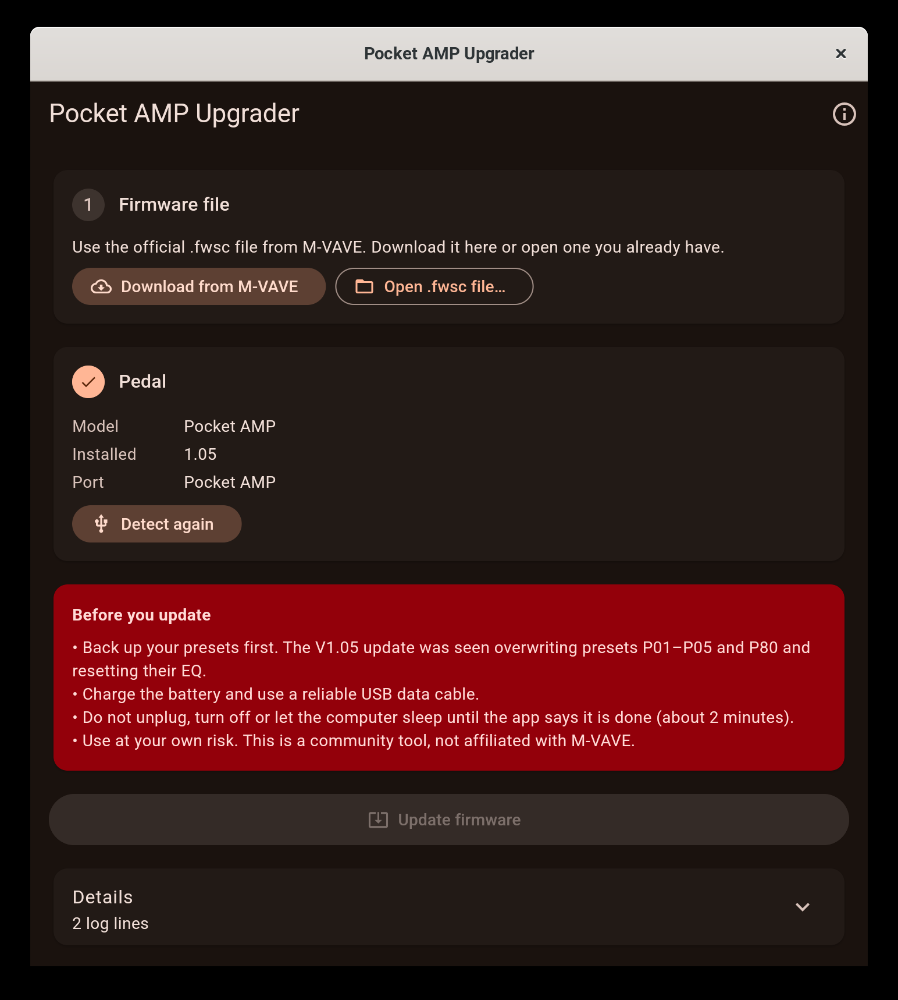

# Pocket AMP Upgrader

[](https://github.com/vitoramaral10/pocket-amp-upgrader/actions/workflows/build.yml)
[](https://github.com/vitoramaral10/pocket-amp-upgrader/releases)
[](https://github.com/vitoramaral10/pocket-amp-upgrader/releases)
[](LICENSE)


Update the firmware of the **M-VAVE Pocket AMP** over USB from **Linux, Windows or macOS**, with the official firmware file from M-VAVE.

M-VAVE's own updater runs only on Windows and, at the time of writing, its "POCKET AMP" bundle ships an older firmware than the one on the downloads page. This app sends the current `.fwsc` file from M-VAVE over plain USB-MIDI, so it needs no drivers.



> **Community tool, not affiliated with M-VAVE. Use at your own risk.** A firmware update that is interrupted can leave the pedal unusable.

## Download

Get the build for your system from the [latest release](../../releases/latest):

| System | File | How to run |
| --- | --- | --- |
| Windows 10/11 (x64) | `pocket-amp-upgrader-windows-x64.zip` | Unzip, run `pocket-amp-upgrader.exe`. If SmartScreen warns, choose *More info → Run anyway*. |
| macOS 11+ | `pocket-amp-upgrader-macos.zip` | Unzip, then right-click *Pocket AMP Upgrader* → *Open* (the app is not signed). |
| Linux (x64) | `Pocket_AMP_Upgrader-x86_64.AppImage` | `chmod +x` it and run it. Or use `pocket-amp-upgrader-linux-x64.tar.gz`. Needs GTK 3 and ALSA (`libasound2`). |

## How to update

1. Know that the update can change presets: V1.05 was seen overwriting P01–P05 and P80 and resetting their EQ (the other presets, names and IRs stayed). The app backs up all 80 presets and their EQ automatically before updating, and you can also save a backup to a file at any time.
2. Charge the pedal, connect it with a USB **data** cable and turn it on.
3. Close the M-VAVE app and anything else that uses MIDI (DAWs, browser tabs with Web MIDI).
4. Open Pocket AMP Upgrader. It detects the pedal and shows the installed version.
5. Click **Download from M-VAVE** (fetches the official file from M-VAVE's server) or **Open .fwsc file…** if you already have it.
6. Click **Update firmware**, confirm, and wait about two minutes. The pedal restarts twice: once into update mode, once into the new firmware.
7. Click **Restore my presets from before the update**. Only the presets and EQ that changed are written back, and the result is read back to check it.

To check the installed version on the pedal itself, hold **Home** and press **>**.

### "Already runs this version"

The Pocket AMP does not reinstall the firmware it already has: it reads the package and stops. The app checks the version first and tells you instead of starting.

### If it stops halfway

Do not unplug the pedal in a hurry. If the app says the pedal did not come back, reconnect it, open the app again and click **Detect pedal**. A pedal waiting in update mode shows up as *update mode*, and **Resume update** writes the firmware again from there.

## Preset backups

The **Presets** card saves all 80 presets and their EQ to a `.json` file and restores one. A restore writes only what differs from the pedal and then reads everything back to confirm. The backup taken automatically before each update is also kept in `Documents/Pocket AMP Upgrader`.

## Safety checks

Before anything is written, the app:

- validates the whole `.fwsc` package (header, directory and CRC of every entry, chip `AC791N`);
- only accepts packages for the Pocket AMP, and only the update loader (`ota.bin`) whose SHA-256 is known (`ef1f2db8…`, the one in the official V1.05 package);
- checks that the pedal on the USB port says it is a Pocket AMP before arming the transfer;
- only asks the pedal for its identity when it opens; presets are read only when you start an update or save a backup, and nothing is written until you confirm.

## Status

| Platform | Detection | Full update |
| --- | --- | --- |
| Linux | tested with a real pedal; preset backup and restore too | the app's traffic was traced side by side with the Python prototype that updated a real pedal from V1.03 to V1.05: same requests, same answers. A full update by the app itself waits for the next firmware, because the pedal refuses to reinstall the version it already runs |
| Windows | not yet tested on hardware | not yet tested on hardware |
| macOS | not yet tested on hardware | not yet tested on hardware |

Reports are very welcome, including "it worked": use the [hardware test report](../../issues/new?template=hardware_report.yml) form.

## Help wanted

This is a community project and the next step depends on owners of the pedal:

- **Windows and macOS testers.** Open the app with your pedal connected and [tell us what you see](../../issues/new?template=hardware_report.yml). Detection alone is already useful.
- **Bug reports** with the log from **Details → Copy for a bug report** ([form](../../issues/new?template=bug_report.yml)).
- **Questions, tips and other pedals** go to [Discussions](../../discussions).
- **Code and docs**: see [CONTRIBUTING.md](CONTRIBUTING.md). Translations of this README are welcome.

If the app helped you, a ⭐ makes it easier for other Pocket AMP owners to find it.

## Troubleshooting

- **No pedal found.** Try another cable (many are charge-only) and another USB port. Make sure no other app has the MIDI port open. On Linux your user needs access to `/dev/snd/midi*` (usually the `audio` group or a desktop session).
- **"Could not open MIDI output" on Windows.** Another app owns the port; Windows lets only one app open a MIDI device at a time.
- **macOS says the app is damaged.** Run `xattr -dr com.apple.quarantine "Pocket AMP Upgrader.app"` once.

## How it works

The Pocket AMP runs on a JieLi AC791N, the same chip as the M-VAVE FM-1, and uses the same update loader. The protocol was learned from the browser updater that M-VAVE published in [FM1 Open](https://github.com/m-vave/fm1_open) (`sdk/WebUpdate.js`):

- frames are SysEx `F0 <7-bit packed [00 59 cmd len_lo len_hi 00 payload ~sum]> F7`;
- command `0x11` returns the identity (`Pocket AMP_105`, or `ota-Pocket AMP_103` in update mode);
- the raw message `F0 22 24 35 7F F7` arms a transfer, after which the pedal requests blocks with command `0x30` (`[seq, address u32, size u24]`) and the app answers with the bytes of the package;
- a request for address `0xE0000000` ends the loader phase and `0xF0000000` ends the flash phase; both are answered with `success\0`, and the pedal restarts.

The USB-MIDI transport is native on each system: ALSA rawmidi on Linux, WinMM on Windows (each SysEx send waits for the driver to finish with the buffer) and CoreMIDI on macOS (through [flutter_midi_command](https://pub.dev/packages/flutter_midi_command)).

## Building

Requires Flutter 3.47 or newer.

```bash
flutter pub get
flutter test
flutter build linux     # or windows / macos, on that system
```

`flutter test test_hardware/` talks to a real pedal on Linux (identity query only). Set `POCKET_AMP_FWSC=/path/to/Pocket\ AMP.fwsc` to also run the tests against the official package.

## Contributing

See [CONTRIBUTING.md](CONTRIBUTING.md) and the [Code of Conduct](CODE_OF_CONDUCT.md). Safety problems (a way to write wrong data to a pedal) go through [private reporting](SECURITY.md).

## License

GPL-3.0-only. The update protocol follows M-VAVE's FM1 Open browser updater, which is GPL-3.0. M-VAVE, Pocket AMP and FM-1 are trademarks of their owners; the firmware belongs to M-VAVE and is not distributed with this app.
